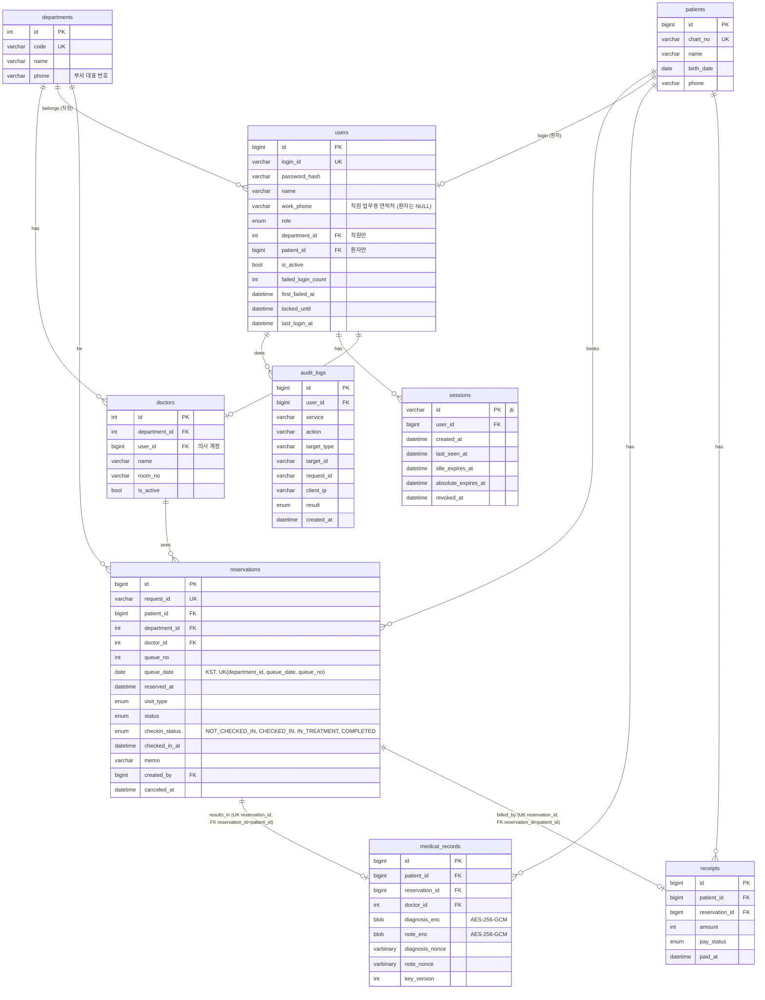

# ERD — 병원 예약 시스템 (DB 1개)

## 원칙
- MySQL 8.4 **1대, 데이터베이스(스키마) 1개 `hospital`**. 복제·승격·검증은 이 DB 하나만 한다.
- FastAPI 서비스 3개가 같은 DB를 쓰되, **표마다 "주인 서비스"를 정해서 주인만 쓰기**를 한다. 다른 서비스는 읽기만 한다.
- DB 계정 (보안 설정표 기준): `app_runtime`(auth·reservation, 데이터 작업만), `app_readonly`(stats·검증 도구, 조회만), `app_migrate`(표 생성·변경, 배포 전 별도 단계). 앱 연결은 TLS(CA·서버 이름 검증).
- 시간은 모두 **UTC**로 저장 (`DATETIME(6)`), 응답은 `Z`로 끝나는 ISO 8601. 화면에서만 KST로 표시.
- 문자셋 `utf8mb4`. `request_id`만 대소문자 구분을 위해 `utf8mb4_bin`.
- 앱이 시작할 때 표를 자동으로 만들지 않는다. 표는 `db/schema.sql`로 `app_migrate`가 원본(병원) DB에만 만든다 (복제 DB는 read_only/super_read_only).

## 표 주인

| 주인 서비스 | 표 |
|---|---|
| 인증 서비스 (auth) | `users`, `sessions`, `audit_logs` (단, `audit_logs`는 모든 서비스가 INSERT 가능, `sessions`는 모든 서비스가 조회·last_seen 갱신) |
| 예약 서비스 (reservation) | `departments`, `doctors`, `patients`, `reservations`, `medical_records`, `receipts` |
| 현황 서비스 (stats) | 없음 (전부 조회만) |

## 그림

## 표 상세

모든 표에 `created_at`, `updated_at` (`DATETIME(6)`, UTC)을 둔다 (아래 표에서는 생략).

### users (계정) — 주인: 인증
| 칸 | 타입 | 설명 |
|---|---|---|
| id | BIGINT PK | |
| login_id | VARCHAR(50) UNIQUE | 로그인 아이디 |
| password_hash | VARCHAR(255) | bcrypt 해시 (원문 저장 금지) |
| name | VARCHAR(50) | |
| role | ENUM | `PATIENT`, `NURSE`, `DOCTOR`, `MANAGER`(원무과장), `ADMIN`, `DEPT_HEAD`, `DIRECTOR`, `DEVELOPER`, `TESTER` |
| department_id | INT NULL FK | 직원의 소속 부서. 원무 담당은 원무과 부서 → `/manage` |
| patient_id | BIGINT NULL FK | 환자 계정만 |
| is_active | BOOL | 비활성 계정은 로그인 불가 |
| failed_login_count | INT | 15분 안 실패 횟수 (5회면 잠금) |
| first_failed_at | DATETIME(6) NULL | 실패 횟수 세기 시작 시각 |
| locked_until | DATETIME(6) NULL | 잠금 해제 시각 (실패 5회 → 15분) |
| last_login_at | DATETIME(6) NULL | |

### sessions (로그인 세션) — 주인: 인증  (보안 DEV3)
| 칸 | 타입 | 설명 |
|---|---|---|
| id | VARCHAR(64) PK | JWT `jti` |
| user_id | BIGINT FK | |
| last_seen_at | DATETIME(6) | 요청마다 갱신 (1분에 한 번만 UPDATE) |
| idle_expires_at | DATETIME(6) | 일반 30분 / 관리 화면 15분 |
| absolute_expires_at | DATETIME(6) | 일반 8시간 / 관리 화면 4시간 |
| revoked_at | DATETIME(6) NULL | 로그아웃·비활성화·역할 변경 시 기록 → 이후 401 |

READ_ONLY_MODE(DR 대기)일 때는 세션을 새로 만들 수 없다. DR 전환 후 다시 로그인한다.

### departments (진료과·부서) — 주인: 예약
| 칸 | 타입 | 설명 |
|---|---|---|
| id | INT PK | |
| code | VARCHAR(20) UNIQUE | 예: `IM`(내과), `OS`(정형외과), `ADM`(원무과) |
| name | VARCHAR(50) | |
| phone | VARCHAR(20) NULL | 부서 대표 번호. 응답에서 공개 범위 적용 (아래 "전화번호 공개 범위") |

### doctors (의사) — 주인: 예약
| 칸 | 타입 | 설명 |
|---|---|---|
| id | INT PK | |
| department_id | INT FK | |
| user_id | BIGINT NULL FK(users) | 의사 로그인 계정 (참고: 다운님 예시) |
| name | VARCHAR(50) | |
| room_no | VARCHAR(20) NULL | 진료실 |
| is_active | BOOL | |

### patients (환자) — 주인: 예약
| 칸 | 타입 | 설명 |
|---|---|---|
| id | BIGINT PK | |
| chart_no | VARCHAR(20) UNIQUE | 차트 번호 |
| name | VARCHAR(50) | |
| birth_date | DATE | |
| phone | VARCHAR(20) NULL | 개인정보. 응답에서 공개 범위 적용 (아래 "전화번호 공개 범위"). 암호화 저장은 보안 담당과 협의 중 |

### reservations (예약) — 주인: 예약  ★DR 검증 대상
| 칸 | 타입 | 설명 |
|---|---|---|
| id | BIGINT PK | |
| request_id | VARCHAR(64) UNIQUE, `utf8mb4_bin` | X-Request-ID. 같은 값이면 1건만 저장 |
| patient_id | BIGINT FK | |
| department_id | INT FK | |
| doctor_id | INT NULL FK | |
| queue_no | INT NULL | 접수 시 부서별·날짜별 대기번호 (참고: 다운님 예시) |
| queue_date | DATE NULL | 대기번호를 매긴 날짜 (KST). 접수 때 저장. 접수 전에는 NULL |
| reserved_at | DATETIME(6) | 진료 예약 시각 (UTC) |
| visit_type | ENUM | `FIRST`(초진), `RETURN`(재진) |
| status | ENUM | `BOOKED`, `CANCELED` (취소해도 행은 남김) |
| checkin_status | ENUM | `NOT_CHECKED_IN`(접수 전), `CHECKED_IN`(진료대기), `IN_TREATMENT`(진료중), `COMPLETED`(진료완료). 앞으로만 간다 (건너뛰기·되돌리기는 앱이 409) |
| checked_in_at | DATETIME(6) NULL | |
| memo | VARCHAR(500) NULL | |
| created_by | BIGINT NULL FK(users) | 예약을 만든 계정 |
| canceled_at | DATETIME(6) NULL | |

인덱스: `(department_id, reserved_at)`, `(patient_id, reserved_at)`, `(doctor_id, reserved_at)`.

UNIQUE:
- `uq_reservations_queue (department_id, queue_date, queue_no)` — 같은 진료과·같은 날 대기번호 중복 방지. `queue_date`·`queue_no` 가 NULL 인 접수 전 예약은 몇 건이든 걸리지 않는다.
- `uq_reservations_id_patient (id, patient_id)` — 진료기록·영수증의 복합 외래키 대상 (예약과 환자가 함께 일치해야 저장).

진료 진행: `NOT_CHECKED_IN → CHECKED_IN → IN_TREATMENT → COMPLETED`. 진료중·진료완료 예약은 취소할 수 없다. 진료 시작·완료는 그 예약의 담당 의사(`doctors.user_id` = 로그인 계정)만 하고 감사 로그 `TREATMENT_START`·`TREATMENT_COMPLETE` 를 남긴다.

### medical_records (진료기록) — 주인: 예약
| 칸 | 타입 | 설명 |
|---|---|---|
| id | BIGINT PK | |
| patient_id | BIGINT FK | |
| reservation_id | BIGINT NULL UNIQUE | 예약 1건에 기록 최대 1건. `(reservation_id, patient_id)` → `reservations (id, patient_id)` 복합 FK 로 예약의 환자와 같아야 한다 |
| doctor_id | INT FK | |
| diagnosis_enc | BLOB | AES-256-GCM 암호문 + 인증 태그 |
| note_enc | BLOB | AES-256-GCM 암호문 + 인증 태그 |
| diagnosis_nonce | VARBINARY(12) | diagnosis 암호화용, 매번 새로 생성 (재사용 금지) |
| note_nonce | VARBINARY(12) | note 암호화용, 매번 새로 생성 (재사용 금지) |
| key_version | INT | 키 교체 대비 |

암호화·복호화는 `shared/crypto.py` 한 곳에서만 한다 (보안 담당 주도). 키는 환경변수 또는 KMS로 받는다.

### receipts (영수증) — 주인: 예약
| 칸 | 타입 | 설명 |
|---|---|---|
| id | BIGINT PK | |
| patient_id | BIGINT FK | |
| reservation_id | BIGINT NULL UNIQUE | 예약 1건에 영수증 최대 1건. `(reservation_id, patient_id)` → `reservations (id, patient_id)` 복합 FK 로 예약의 환자와 같아야 한다 |
| amount | INT | 원 단위 |
| pay_status | ENUM | `PAID`, `UNPAID`, `REFUNDED` |
| paid_at | DATETIME(6) NULL | |

진료기록·영수증은 처음에는 **조회만** 한다 (생성 API 없음. 진료(EMR)·수납 화면은 "준비 중").
`reservation_id` 가 NULL 이면 복합 외래키는 검사하지 않는다 (예약 없는 기록·영수증은 `patient_id` 만 맞으면 됨).

이미 만든 DB 는 `db/migrate_002.sql` 로 옮긴다 (칸·UNIQUE·복합 외래키 추가, `departments.phone`·`users.work_phone` 추가).
다시 실행해도 된다: 이미 있는 칸·키·외래키는 건너뛴다.

### 전화번호 공개 범위 (보안 담당 확정)
저장된 번호는 그대로 두고, **서버 응답을 만들 때** 역할에 따라 전체 번호 또는 가린 번호(`010-****-1234`)를 내보낸다. 규칙은 `shared/phone.py` 한 곳이다.

| 역할 | 환자 번호 | 부서 대표 번호 | 직원 업무용 연락처 |
|---|---|---|---|
| PATIENT | 본인 것만 전체 | 전체 | (조회 API 없음) |
| MANAGER (원무과장) | 모든 환자 전체 | 가림 | 모든 직원 전체 |
| NURSE | 자기 부서에 예약(취소 아님)이 있는 환자만 전체, 나머지 가림 | 원무과(`ADM`)만 전체, 나머지 가림 | 자기 부서 직원만 전체 (다른 부서 직원은 목록에 나오지 않음) |
| DOCTOR | 가림 | 가림 | 자기 부서 부서장만 전체 |
| DEPT_HEAD | 가림 | 가림 | 자기 부서 직원 전체 |
| DIRECTOR | 가림 | 가림 | 자기 부서 직원 + 모든 부서 부서장 전체 |
| ADMIN, DEVELOPER, TESTER | 전부 가림 | 전부 가림 | (목록 없음) |

- 감사 로그(`audit_logs`)에는 번호를 넣지 않는다 (`target_id` 는 환자 id). 앱 로그는 경로만 남기고 요청·응답 본문을 남기지 않는다.

### audit_logs (감사 로그) — 주인: 인증 (모든 서비스 INSERT)
| 칸 | 타입 | 설명 |
|---|---|---|
| id | BIGINT PK | |
| user_id | BIGINT NULL FK | 로그인 실패는 NULL |
| service | VARCHAR(20) | `auth`, `reservation`, `stats` |
| action | VARCHAR(50) | 예: `LOGIN`, `RESERVATION_CREATE`, `RECORD_VIEW` |
| target_type | VARCHAR(30) NULL | |
| target_id | VARCHAR(64) NULL | |
| request_id | VARCHAR(64) NULL | |
| client_ip | VARCHAR(45) NULL | |
| result | ENUM | `SUCCESS`, `DENIED`, `FAIL` |
| created_at | DATETIME(6) | |

READ_ONLY_MODE일 때는 감사 로그를 DB에 쓰지 않고 표준 출력 로그로만 남긴다.

## 개발 범위 밖
- `dr_heartbeat` (RPO 측정용) — DB·모니터링 담당 소관. 같은 DB에 있어도 앱은 건드리지 않는다.
