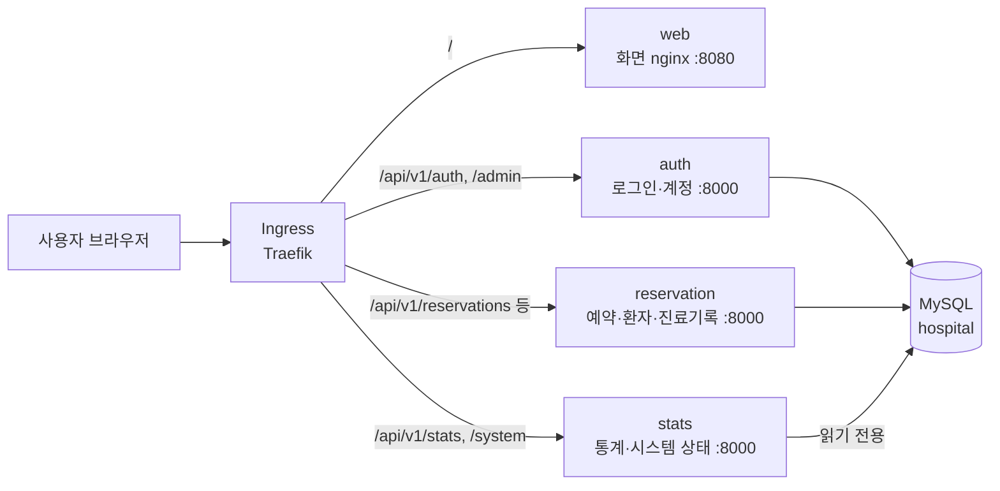

# 처음 보는 사람을 위한 안내 (전체 구조 · 어디를 보면 되는지)

코드를 처음 열어 보는 팀원이 **전체 그림 → 내 담당 부분 → 바꿀 값** 순서로 빠르게 찾을 수 있게 정리한 문서입니다.
자세한 내용은 각 문서(`api-spec.md`, `erd.md`, `db-setup-guide.md`, `permissions-matrix.md`)를 보면 됩니다.

---

## 1. 한눈에 보기

- 화면 1개 + API 서비스 3개 + DB 1개입니다.
- API 서비스끼리는 서로 호출하지 않습니다. 셋 다 같은 DB와 같은 로그인 키(`JWT_SECRET`)를 씁니다.
- 예외: stats의 시스템 상태 API가 auth·reservation의 `/readyz`를 확인합니다.

| 서비스 | 하는 일 | DB 계정 | 받는 비밀값 |
|---|---|---|---|
| web | 화면 (React → nginx) | 없음 | 없음 |
| auth | 로그인, 세션, 직원 계정 관리 | `app_runtime` | DB 비밀번호, JWT |
| reservation | 예약, 대기열, 환자, 진료기록, 연락처 | `app_runtime` | DB 비밀번호, JWT, MEDICAL_KEY |
| stats | 통계, 시스템 상태 | `app_readonly` (조회만) | DB 비밀번호, JWT |

---

## 2. 저장소 5개

| 저장소 | 들어 있는 것 | 주로 보는 사람 |
|---|---|---|
| `hospital-frontend` | 화면 코드, nginx 설정, Dockerfile | 개발 |
| `hospital-backend-auth` | 인증 서비스 | 개발, 보안 |
| `hospital-backend-reservation` | 예약 서비스 | 개발 |
| `hospital-backend-stats` | 현황 서비스 | 개발, 모니터링 |
| `hospital-gitops` | **배포 설정(Helm)**, DB 스키마, 문서, 검증 도구 | **온프레미스, AWS, 보안, 모니터링 모두** |

- 인프라 담당은 거의 `hospital-gitops`만 보면 됩니다.
- 백엔드 3개 저장소의 `shared/` 폴더는 **세 곳 모두 같은 내용**입니다 (DB 연결, 로그인 검사, 로그 등 공통 코드).
- 앱 코드(app/, shared/, src/)는 개발 담당이 한곳에서 고친 뒤 5개 저장소로 복사합니다.
  앱 코드를 바꿔야 하면 직접 고치기보다 **개발 담당에게 요청**해 주세요. 직접 고치면 다음 복사 때 덮어써질 수 있습니다.

---

## 3. 이미지

| 서비스 | 이미지 (원본) | 태그 |
|---|---|---|
| auth | `ghcr.io/kt-duck-cloud/reservation-app-auth` | `b3f7632` |
| reservation | `ghcr.io/kt-duck-cloud/reservation-app-reservation` | `b3f7632` |
| stats | `ghcr.io/kt-duck-cloud/reservation-app-stats` | `b3f7632` |
| web | `ghcr.io/kt-duck-cloud/reservation-app-web` | `b3f7632` |

- 공개(Public) 패키지라 로그인 없이 받을 수 있습니다.
- 온프레미스는 Harbor(`100.64.0.41:8086/duckcloud/...`), AWS는 ECR로 옮겨서 씁니다.
  `ghcr → Harbor / ECR` 로 옮긴 뒤, values 파일의 `tag`를 같은 값으로 맞춥니다.
- 태그는 Git 커밋 번호입니다. `latest`는 어떤 버전인지 알 수 없고, `pullPolicy: IfNotPresent`라 새 이미지를 받지 않을 수 있어서 쓰지 않습니다.
- 모든 이미지는 root가 아닌 사용자로 실행됩니다 (백엔드 uid 10001, web uid 101).

---

## 4. 배포 설정 (Helm) 읽는 법

파일 위치: `hospital-gitops/helm/reservation-app/`

| 파일 | 역할 |
|---|---|
| `values.yaml` | **모든 사이트 공통 기본값**. 설명 주석이 가장 자세합니다. |
| `values-onprem.yaml` | 온프레미스(1조)만 다른 값 |
| `values-aws.yaml` | AWS(2조)만 다른 값. 평소 대기 상태 |
| `values-dr-active.yaml` | DR 전환 때 AWS에 덧붙이는 값 (쓰기 허용 + 앱 기동) |
| `templates/` | 실제 쿠버네티스 리소스 틀 (보통 고칠 일 없음) |

적용 순서: `values.yaml` → 사이트 파일 → (DR 때) `values-dr-active.yaml`. 뒤에 오는 값이 앞의 값을 덮어씁니다.

### 사이트별로 다른 값

| 값 | 의미 | 온프레미스 | AWS (평소) | AWS (DR 전환 후) |
|---|---|---|---|---|
| `siteName` | 화면에 보이는 사이트 이름 | `hospital` | `aws` | `aws` |
| `readOnlyMode` | `true`면 쓰기(예약·로그인 등)를 503으로 막음 | `false` | `true` | `false` |
| `replicaCount` | 서비스별 Pod 수 | 1 | 0 | 1 |
| `dbUrl` | DB 주소 (계정·비밀번호 없이) | `mysql://db-service:3306/hospital` | AWS DB 주소 | 같음 |
| `image.repository` | 이미지 위치 | Harbor | ECR | 같음 |
| `image.tag` | 이미지 버전 | `b3f7632` | `b3f7632` | 같음 |
| `ingress.className` | 인그레스 컨트롤러 | `traefik` | `traefik` | 같음 |
| `forwardedAllowIps` | 실제 사용자 IP를 믿을 프록시 주소 | 인그레스 컨트롤러 Pod 대역 | 인그레스 컨트롤러 Pod 대역 | 같음 |

`forwardedAllowIps`가 기본값(`127.0.0.1`)이면 모든 요청이 인그레스 IP 하나로 보여서, 로그인 제한(IP당 분당 20회)을 전체 사용자가 나눠 쓰게 됩니다.

---

## 5. 비밀값 (Kubernetes Secret)

차트는 Secret을 **만들지 않고 이름만 참조**합니다. 사이트마다 담당자가 namespace `hospital`에 직접 만들어 둡니다. 값은 Git에 올리지 않습니다.

| Secret 이름 | 키 | 무엇 | 사이트 간 같은 값? |
|---|---|---|---|
| `reservation-app-db-runtime` | `DB_PASSWORD` | `app_runtime` 계정 비밀번호 (auth, reservation) | DB 복제 구성에 맞춰 결정 |
| `reservation-app-db-readonly` | `DB_PASSWORD` | `app_readonly` 계정 비밀번호 (stats). 위와 다른 값 | DB 복제 구성에 맞춰 결정 |
| `reservation-app-jwt` | `JWT_SECRET` | 로그인 토큰 서명 키 (32바이트 이상) | 달라도 됨 (전환 후 다시 로그인) |
| `reservation-app-medical-key` | `MEDICAL_KEY`, `MEDICAL_KEY_VERSION` | 진료기록 암호화 키 (base64 32바이트) | **반드시 같아야 함** (다르면 DR 후 진료기록을 못 읽음) |
| `reservation-app-db-migrate` | `client.cnf` | 표 만들기 Job 전용 (`app_migrate` 계정). 처음 설치할 때만 | — |
| (선택) `secrets.dbCa.name` | `ca.pem` | DB TLS 인증서 검증용 CA. 없으면 암호화만 하고 검증은 안 함 | 사이트별 |

DB 계정 이름(`app_runtime` 등)과 DB 주소는 비밀값이 아니라서 values 파일에 있습니다.

---

## 6. 포트와 상태 확인 주소

| 무엇 | 포트 / 주소 |
|---|---|
| API 서비스 컨테이너 | 8000 |
| web 컨테이너 | 8080 |
| Service (클러스터 안) | 80 |
| `/metrics` 수집용 NodePort | reservation 30800, auth 30801, stats 30802 |
| 온프레미스 Traefik 입구 | 30080 (온프레미스 설정) |
| 살아 있는지 | `/healthz` (DB와 상관없이 앱 프로세스만) |
| 요청 받을 준비 | `/readyz` (DB 연결 확인, 실패 시 503) |
| 지표 | `/metrics` (Prometheus 형식) |

---

## 7. 코드에서 고정된 값 (어디서 바꾸는지)

| 값 | 현재 | 위치 |
|---|---|---|
| 로그인 요청 제한 | IP당 분당 20회 | `values.yaml` `loginRateLimitPerMinute` |
| 계정 잠금 | 15분 안 5회 실패 → 15분 잠금 | auth `app/main.py` |
| 세션 만료 | 유휴 30분 / 최대 8시간 (관리자·원장 15분 / 4시간) | `shared/auth.py` |
| DB 연결 풀 | 5 + 여유 5, 대기 5초, 1800초마다 새 연결 | `values.yaml` `dbPool` |
| 종료 대기 | preStop 5초 + 처리 중 요청 최대 20초 (전체 30초 안) | `values.yaml`, 각 Dockerfile |
| 병원 대표 번호 | `02-0000-0000` (가짜) | `values.yaml` `hospitalPhone` |
| 진료기록 키 버전 | 1 | `values.yaml` `medicalKeyVersion` |

---

## 8. 문서·코드에 나오는 약어

| 약어 | 뜻 | 어디에 정의 |
|---|---|---|
| A1~A7 | 인증 서비스 API 번호 | `api-spec.md` 3장 |
| R1~R19 | 예약 서비스 API 번호 | `api-spec.md` 3장 |
| S1~S4 | 현황 서비스 API 번호 | `api-spec.md` 3장 |
| P1~P3 | 기능 우선순위 (P1이 가장 먼저) | `api-spec.md` 3장 |
| DEV2, DEV3 | 보안 요구사항 번호 (로그인 제한, 세션 만료) | 보안 점검 요구사항 |

역할 코드: `PATIENT` 환자, `NURSE` 간호사, `DOCTOR` 의사, `MANAGER` 원무과장, `ADMIN` 관리자, `DEPT_HEAD` 부서장, `DIRECTOR` 원장, `DEVELOPER` 개발자, `TESTER` 테스터. 역할별 권한은 `permissions-matrix.md`.

---

## 9. 담당별로 먼저 볼 곳

| 담당 | 먼저 볼 것 | 정해서 넣을 것 |
|---|---|---|
| 온프레미스 | 4장, 5장, `values-onprem.yaml`, `db-setup-guide.md` | Harbor 이미지·태그, `forwardedAllowIps`, Secret, DB 계정·스키마 |
| AWS | 4장(DR 전환), 5장, `values-aws.yaml`, `values-dr-active.yaml` | ECR 주소·태그, `dbUrl`, `forwardedAllowIps`, Secret (MEDICAL_KEY는 온프레미스와 같게) |
| 보안 | 3장(이미지), 5장, 7장, `permissions-matrix.md` | 이미지 검사, 비밀값 관리 방식 |
| 모니터링 | 6장 (`/metrics`, NodePort, `/readyz`) | 수집 대상, 알림 기준 |
| IaC | 5장, 6장 | Secret 생성, 보안그룹(NodePort 노출 범위) |

---

## 10. 코드를 직접 읽을 때

백엔드 3개는 구조가 같습니다.

| 파일 | 내용 |
|---|---|
| `app/main.py` | API 목록 (주소마다 함수 하나) |
| `shared/config.py` | 환경변수를 읽는 곳. **설정이 궁금하면 여기부터** |
| `shared/permissions.py` | 역할별로 허용된 API 표 |
| `shared/db.py` | DB 연결, 연결 풀, TLS |
| `shared/crypto.py` | 진료기록 암호화 (MEDICAL_KEY) |
| `shared/auth.py` | 로그인 토큰 확인, 세션 만료 |

환경변수 이름과 기본값은 각 백엔드 저장소 `README.md`의 "환경변수" 표에 있습니다.
